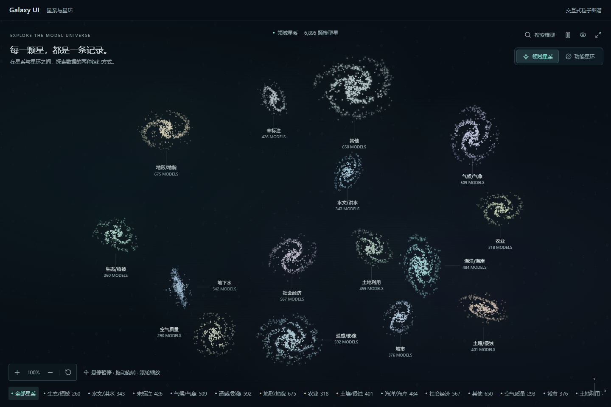
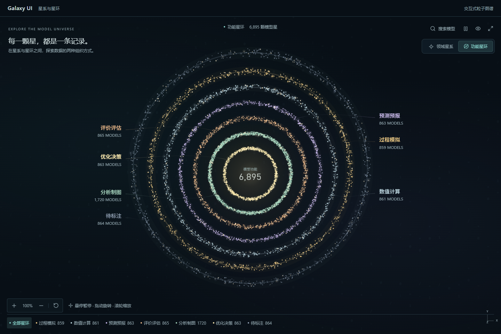

# Galaxy UI · 星系与星环聚类可视化

本项目展示一种基于类别标签的聚类布局与交互可视化方法。同一组数据按研究领域聚成螺旋星系，按模型功能排列为同心星环；切换分组视角时，同一条记录对应的星点沿曲线移动到新位置，便于观察记录在两种分类体系中的归属。

基于 **React + TypeScript + Canvas 2D**。包含 6,895 条合成示例记录，启动后即可浏览，无需后端、数据库或 API Key。




## 方法

1. **按标签分组**：读取每条记录的领域或功能标签，确定所属分组。示例包含 15 个领域分组和 7 个功能分组。
2. **生成空间布局**：领域分组使用固定中心、不同倾角和螺旋臂形成星系；功能分组使用不同半径的同心轨道形成星环。记录 ID 决定组内位置，使布局在输入顺序变化时保持稳定。
3. **关联两种视图**：以唯一 ID 连接两套坐标，通过曲线插值完成布局过渡。搜索、选择和详情帮助追踪单条记录。

当前分组依据是输入数据已有的类别标签，空间坐标由布局规则生成。星点间距用于视觉组织，不作为样本相似度或聚类质量的度量。

方法实现主要位于 `galaxy-layout.ts` 和 `galaxy-morph.ts`，具体计算过程见 [实现原理](docs/ARCHITECTURE.md)。

## 交互

- 星系 / 星环切换，保留记录身份与粒子过渡动画。
- 拖动旋转，滚轮或双指缩放，Shift + 拖动或右键拖动平移。
- 悬停暂停当前分组，移开继续；支持全局暂停和系统减少动态效果偏好。
- 按名称、ID、领域或功能搜索，点击星点或搜索结果查看详情。
- 按分组定位、恢复全景、切换标签、展开星图；支持手机布局。
- 画布聚焦后可用方向键旋转、`+` / `-` 缩放、`Home` 恢复全景。

## 本地运行

使用 Node.js 22.12 或更高版本和 npm。在项目根目录打开终端：

```bash
npm ci
npm run dev
```

打开终端显示的地址，默认是 `http://127.0.0.1:5173`。

```bash
npm test          # 数据校验、相机、布局、轨道与过渡动画测试
npm run build    # 严格 TypeScript 检查并生成 dist/
npm run preview  # 预览构建结果
```

页面通过 HTTP 读取 JSON，请通过上述命令访问，不要直接双击 `index.html`。

## 替换数据

编辑 `public/models.json`，保持 JSON 数组结构。每条记录生成一颗星，`id` 必须唯一且非空。

```json
[
  {
    "id": "my-model-001",
    "name": "流域径流模型",
    "domain": "水文/洪水",
    "task": "模拟",
    "year": 2026,
    "interface_count": 2,
    "reviewed": false
  }
]
```

| 字段 | 类型 | 用途 |
| --- | --- | --- |
| `id` | 非空字符串 | 唯一身份、稳定布局与切换对应关系 |
| `name` | 非空字符串 | 搜索和详情显示 |
| `domain` | 支持的领域名称 | 星系分组 |
| `task` | 非空字符串 | 星环分组 |
| `year` | 整数或 `null` | 详情显示 |
| `interface_count` | 非负整数 | 详情显示 |
| `reviewed` | 布尔值 | 审核标记与星点光环 |

支持的领域：生态/植被、水文/洪水、未标注、气候/气象、遥感/影像、地形/地貌、农业、土壤/侵蚀、海洋/海岸、社会经济、其他、空气质量、城市、土地利用、地下水。

功能映射：模拟 → 过程模拟；计算 → 数值计算；预测 → 预测预报；评估 → 评价评估；分类和制图 → 分析制图；优化 → 优化决策；其他标签 → 待标注。

增减记录即可改变星点数量。要使用自己的分类名称，同时修改 `src/galaxy-layout.ts` 中的布局锚点和 `src/data/models.ts` 中的领域校验列表。当前空间位置用于浏览布局，距离不表示数据相似度；示例中的年份和审核标记也是合成数据。

## 在 React 项目中复用

复制 `src/Galaxy.tsx`、`src/galaxy-*.ts`、`src/galaxy.css`、`src/components/AmbientBackground.tsx` 和 `src/data/models.ts`。引入 `src/style.css` 中的主题变量、基础样式及背景样式，安装 `react`、`react-dom`、`lucide-react` 和 `zod`。

```tsx
import Galaxy from './Galaxy';
import { parseModels } from './data/models';
import './style.css';

// 在数据加载时校验一次，并保持 models 引用稳定。
const models = parseModels(yourJsonData);

<Galaxy
  models={models}
  onSelectionChange={model => console.log(model?.id ?? null)}
/>
```

该组件运行于浏览器。当前视口高度在 `.galaxy-viewport` 中设置，嵌入已有页面时可以按容器调整。

## 实现文件

| 文件 | 职责 |
| --- | --- |
| `src/Galaxy.tsx` | React 状态、切换按钮、搜索和详情 |
| `src/galaxy-layout.ts` | 固定领域锚点、确定性螺旋布局、功能星环 |
| `src/galaxy-renderer.ts` | Canvas 绘制、深度排序、拾取及指针交互 |
| `src/galaxy-camera.ts` | 三维透视投影、旋转、平移与缩放 |
| `src/galaxy-motion.ts` | 各分组独立旋转与悬停暂停 |
| `src/galaxy-morph.ts` | 两种布局之间的曲线插值 |
| `src/galaxy-theme.ts` | Canvas 配色 |
| `src/components/AmbientBackground.tsx` | 独立编写的 Canvas 字符流背景 |
| `src/style.css`、`src/galaxy.css` | 主题、控制栏与响应式布局 |

更多说明见 [实现原理](docs/ARCHITECTURE.md)。

## 许可

[MIT](LICENSE)。可以修改、复用和商用，请保留版权与许可声明。依赖及来源说明见 [THIRD_PARTY_NOTICES.md](THIRD_PARTY_NOTICES.md)。
